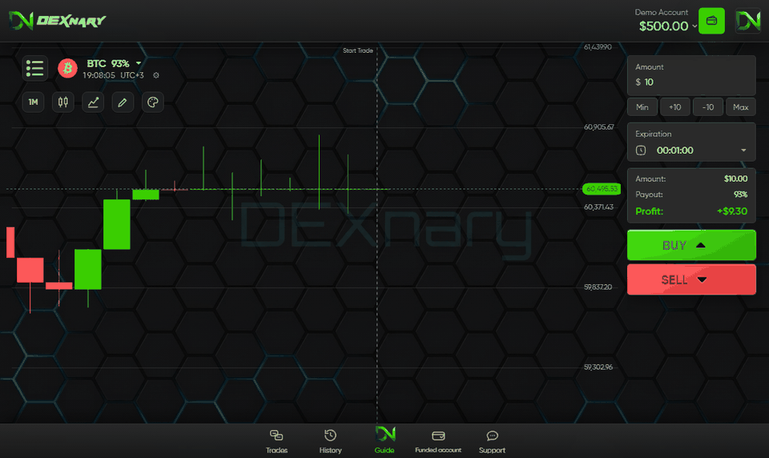
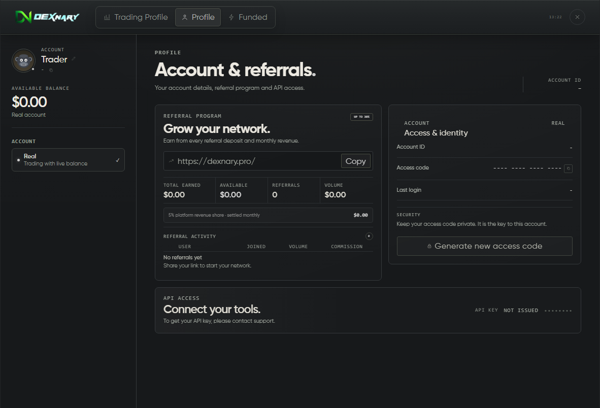
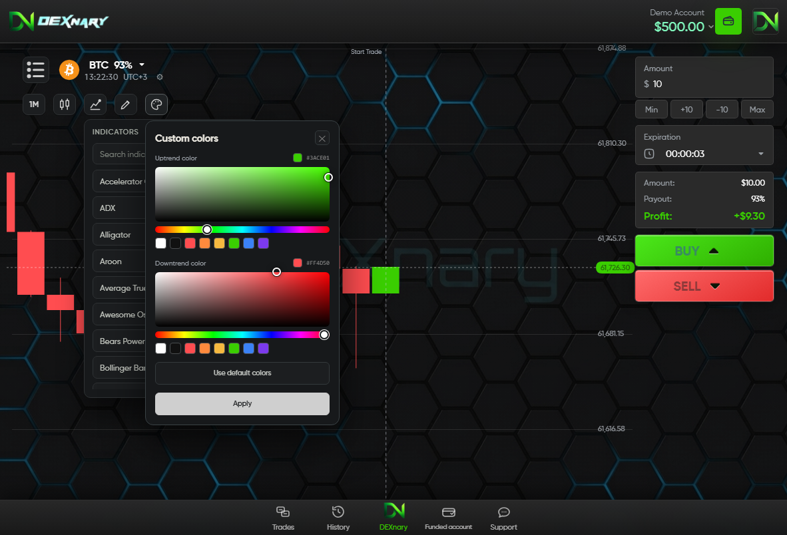
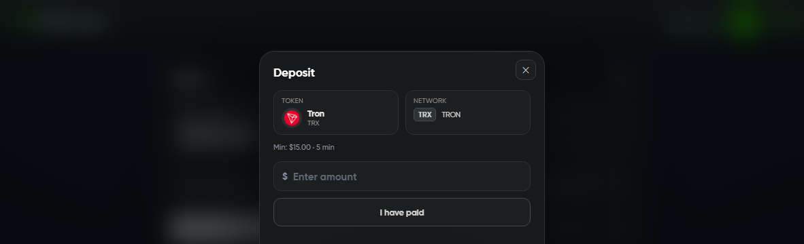
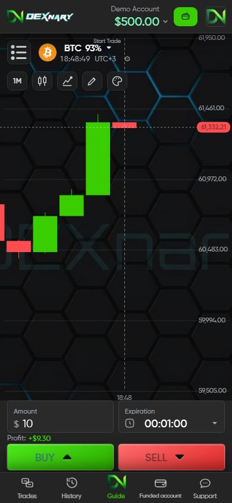
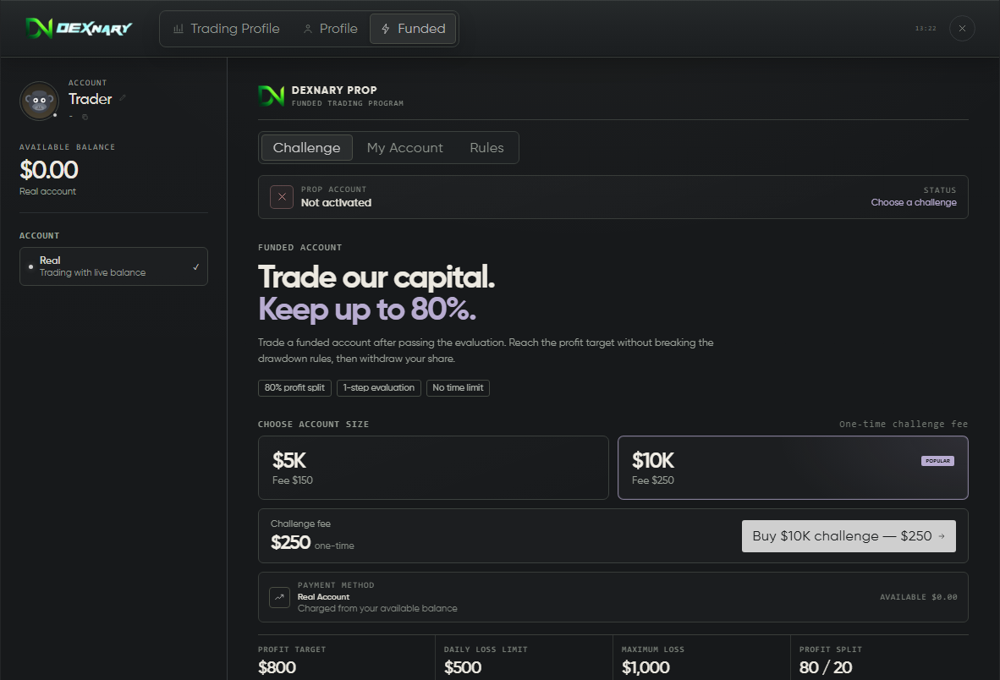
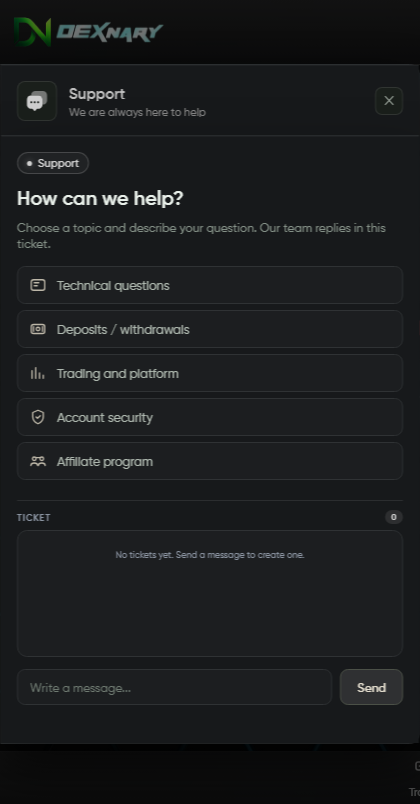

  

<h1 align="center">DEXNARY</h1>

<h3 align="center">Binary Options Platform</h3>

  <b>Trade the chart. Learn in demo. Scale with Funded.</b> 
  A focused binary options terminal for desktop and mobile.

  

  Referral link. Trading involves risk. You can lose your deposit.

  

---

## Why DEXNARY

DEXNARY keeps the important things in one place: the chart, the amount, the expiration and the trade buttons. No crowded dashboards, no unnecessary steps.

- **Binary options trading** with BUY and SELL positions.
- **Multiple crypto markets** in one terminal.
- **Expirations from 3 seconds to 1 day.**
- **Demo, Real and Funded accounts** in one interface.
- **Market-based pricing** for Real trades.
- **Funded challenges** with clear account sizes and rules.
- **Open referral program** with activity and rewards inside Account Center.
- **Built-in support** and a full trading history.
- **Desktop and mobile layouts** that stay consistent.
- **Private by default** — your account details stay inside your account.
- **No KYC, no email** — Your privacy is our priority.

---

## Three accounts. One workflow.

<table>
<tr>
<td width="50%" valign="top">

</td>
<td width="50%" valign="top">

<strong>Demo first.</strong> Practice with a demo balance before using real funds. The terminal, chart and trade flow stay the same.

<strong>Real account.</strong> Deposit, trade and review your history from the same panel.

<strong>Funded challenge.</strong> Explore the $5K and $10K evaluation accounts with clear profit targets and risk limits.

</td>
</tr>
</table>

---

## A chart you can make yours

<table>
<tr>
<td width="55%" valign="top">

</td>
<td width="45%" valign="top">

Choose the chart type, add indicators, switch timeframes and change candle colors.

The color panel updates the chart immediately, so the terminal looks the way you want it to.

</td>
</tr>
</table>

---

## Deposits without the runaround

<table>
<tr>
<td width="45%" valign="top">

Open Wallet, choose a coin and network, enter the amount and confirm the transfer.

The deposit screen keeps the address, QR code and network warning together.

</td>
<td width="55%" valign="top">

</td>
</tr>
</table>

---

## Built for the phone

  

The mobile layout keeps the chart readable and the trade panel within reach. Open Trades, History and Support from the bottom bar.

---

## Positions in plain sight

Open positions and closed trades are separated clearly. Every history entry shows the pair, direction, amount, result and expiration. The active trade stays visible on the chart while it runs.

## Funded challenge

<table>
<tr>
<td width="45%" valign="top">

The Funded tab explains the evaluation before you start: account size, fee, profit target, daily loss limit and maximum drawdown.

Choose $5K or $10K, review the rules, then buy the challenge from your available balance.

</td>
<td width="55%" valign="top">

</td>
</tr>
</table>

## Support inside the terminal

<table>
<tr>
<td width="55%" valign="top">

</td>
<td width="45%" valign="top">

Open Support from the desktop profile menu or the mobile bottom bar.

Choose a topic, describe the issue and follow replies in the ticket drawer.

</td>
</tr>
</table>

---

## What you get

| Feature | What it does |
|---|---|
| **Chart tools** | Candles, line, bars, Heikin Ashi, indicators, timeframes and candle colors |
| **Trade flow** | Amount, expiration, live profit preview, BUY / SELL |
| **Wallet** | Deposit, withdrawal and transaction history |
| **Account Center** | Profile, balance, access details and referral activity |
| **Funded** | $5K and $10K evaluation accounts |
| **Support** | Built-in ticket drawer with clear topics |

---

## Start in three steps

1. **Open DEXNARY** using the button below.
2. **Create an account** and start with Demo if you want to learn the terminal first.
3. **Choose a market, amount and expiration**, then place your first trade.

  

---

## Referral program

If you sign up through my link, I may receive a commission. This does not change your trading terms.

The platform's referral program is displayed inside Account Center, together with referral activity and available rewards.

  <a href="https://dexnary.pro/?ref=8K2F7Q"><b>Open DEXNARY →</b></a>

---

## Risk disclaimer

Trading binary options involves substantial risk. You can lose part or all of your deposit. Nothing in this repository is financial advice, a promise of profit or a guarantee of results. Only trade with money you can afford to lose.

This is an independent visual overview of the platform. Features and terms may change; always check the current information inside DEXNARY.

  

  DEXNARY · Binary options platform · Demo · Real · Funded

